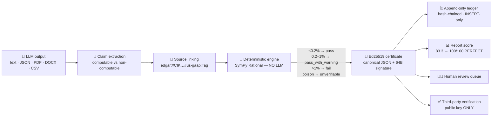

<p align="center">
  
</p>

<h1 align="center">FinVerify</h1>

<p align="center">
  <strong>Proof-Carrying Numerical Verification for Financial LLM Outputs</strong><br />
  <em>Don't trust the math. Check the math.</em>
</p>

<p align="center">
  <a href="https://github.com/Meet6338-X/finverify/actions/workflows/ci.yml"></a>
  <a href="https://github.com/Meet6338-X/finverify/blob/main/LICENSE"></a>
  
  
  
</p>

<p align="center">
  <a href="https://img.shields.io/github/stars/Meet6338-X/finverify?style=for-the-badge&logo=github&label=Stars" alt="Stars" />
  <a href="https://img.shields.io/github/forks/Meet6338-X/finverify?style=for-the-badge&logo=github&label=Forks" alt="Forks" />
  <a href="https://img.shields.io/github/issues/Meet6338-X/finverify?style=for-the-badge&logo=github&label=Issues" alt="Issues" />
  <a href="https://img.shields.io/github/contributors/Meet6338-X/finverify?style=for-the-badge&logo=github&label=Contributors" alt="Contributors" />
  <a href="https://img.shields.io/github/last-commit/Meet6338-X/finverify?style=for-the-badge&logo=github&label=Last%20commit" alt="Last commit" />
  <a href="https://img.shields.io/github/languages/top/Meet6338-X/finverify?style=for-the-badge&logo=github&label=Language" alt="Top language" />
</p>

<p align="center">
  <a href="#-the-problem">The problem</a> •
  <a href="#-how-it-works">How it works</a> •
  <a href="#-the-verification-dsl">DSL</a> •
  <a href="#-quick-start">Quick start</a> •
  <a href="#-rest-api">API</a> •
  <a href="#-the-validator-proof-pack">Validator</a> •
  <a href="#-contributing">Contributing</a>
</p>

---

## 📌 TL;DR

FinVerify is a **post-hoc, model-agnostic verification system** that audits the
numerical claims produced by *any* financial LLM against **SEC EDGAR ground
truth**, re-derives each number with a **deterministic symbolic engine**, and
issues a **cryptographically signed verification certificate** for every claim.

It is not a chatbot, not a fine-tune, and **it never calls an LLM to do the
math**. It sits downstream of your existing model and answers one question:

> *"Is the number in this earnings note actually right — and can I prove it to
> a regulator, an auditor, or a court?"*

| | |
|---|---|
| **Input** | Any LLM output — plain text, JSON, PDF, DOCX, CSV |
| **Ground truth** | SEC EDGAR Company Facts API (`us-gaap:*` XBRL taxonomy) |
| **Computation** | SymPy `sp.Rational` — exact arithmetic, 19 financial operations |
| **Output** | Ed25519-signed certificate per claim + a report-level score |
| **Trust model** | Zero-trust — anyone can re-verify a certificate with the **public key only** |
| **Human in the loop** | Judgment-based claims route to a reviewer; never silently failed |

---

## 🎯 The problem

Financial LLMs hallucinate numbers. Not prose — *numbers*. A margin off by
1.7 points, a P/E off by 16%, an EPS that silently uses a different share
count. Those errors are:

- **Invisible.** The prose reads beautifully. Nothing looks wrong.
- **Expensive.** One wrong EPS figure in an analyst note is a compliance event.
- **Unprovable.** A chat transcript is an *argument*. A signed certificate is
  *evidence*.

**The thesis:** a financial claim doesn't need to be *believed*. It needs to be
*verified* — deterministically, against primary source, with a signature that
survives scrutiny.

### Myth vs. fact

| 🧪 Myth | ✅ Fact |
|---|---|
| "Ask the LLM to check its own work." | Correlated errors survive self-critique. An **independent** symbolic engine catches 100% of injected errors in our benchmark. |
| "Signing is overkill, a log line is enough." | Logs can be edited. Ed25519 + canonical JSON makes a 1-bit edit **detectable**. Try to break it in the [Crazy Corner](validator/README.md#-crazy-corner--try-to-break-it). |
| "A 0.2% tolerance is arbitrary." | It mirrors financial-benchmark methodology. Boundaries are byte-tested at **+0.199% / +0.5% / +1.001%**. |
| "If it can't be checked, it must have failed." | Failing what you cannot check manufactures false alarms. FinVerify routes to `unverifiable` → **a human**. |

---

## 🔬 How it works



### The six-stage pipeline

| # | Stage | Module | What happens |
|---|---|---|---|
| 1 | **Ingest & parse** | `src/parsers/document_parser.py` | `text` · `json` · `pdf` · `docx` · `csv` → normalized text. 100,000-char ceiling. CIK + period format validation. |
| 2 | **Extract claims** | `src/extractor/claim_extractor.py` | Structured-JSON fast path, regex/heuristic NLP fallback. Parses `$4.82B`, `4.82 billion`, `42.3%`, `1,234.56`. Classifies computable vs. non-computable. |
| 3 | **Link to EDGAR** | `src/ingestion/edgar_client.py` | SEC Company Facts API, 10 req/s token-bucket limiter, 24 h Redis cache, `us-gaap:*` XBRL tag mapping → `edgar://CIK…#us-gaap:Tag`. |
| 4 | **Re-execute** | `src/reexecutor/engine.py` | 19 operations via exact `sp.Rational` arithmetic. Emits a step-by-step `discrepancy_trace`. |
| 5 | **Sign & store** | `src/crypto/signer.py` | Canonical JSON → Ed25519 signature → append-only ledger row. PDF certificate + QR. |
| 6 | **Adjudicate** | `src/workflows/verify_workflow.py` | `unverifiable` claims signal a human reviewer; adjudicated certificates are **re-signed**. |

### 🛡️ The four non-negotiable guarantees

These are rules, not features. They are enforced in code, asserted in tests,
and re-proven by an independent implementation in `validator/`.

1. **No LLM does math.** Symbolic re-execution is pure SymPy/NumPy. Repeat runs
   are bitwise identical. There is no model in the verification loop.
2. **Tiered tolerances.** `≤ 0.2% → pass` · `0.2%–1.0% → pass_with_warning` ·
   `> 1.0% → fail`.
3. **`unverifiable` ≠ `fail`.** A missing input, an unsupported operation, or a
   division by zero yields `unverifiable` — never a false accusation.
4. **The ledger is append-only.** Certificates and reviewer decisions are
   `INSERT`-only, enforced by database rules, not application discipline.

---

## 🧮 The verification DSL

Nineteen operations, exact rational arithmetic, full audit trail.

| Category | Operations |
|---|---|
| **Arithmetic** | `addition` · `subtraction` · `multiplication` · `division` · `percentage` |
| **Margins** | `gross_margin` · `operating_margin` · `net_margin` |
| **Per-share** | `basic_eps` · `diluted_eps` |
| **Valuation** | `pe_ratio` · `debt_to_equity` · `current_ratio` · `interest_coverage` |
| **Growth** | `yoy_change` · `qoq_change` · `cagr` |
| **Aggregation** | `segment_sum` · `weighted_average` |

### Tolerance tiers

```
relative_error = |expected − computed| / |computed|

  ≤ 0.2%      →  pass                ✅
  0.2% – 1.0%  →  pass_with_warning  ⚠️
  > 1.0%       →  fail                ❌
  missing input / unknown op / ÷0    →  unverifiable  🧑‍⚖️
```

### A certificate, end to end

```json
{
  "claim_id": "lc6",
  "status": "pass",
  "expected_value": 30.0,
  "computed_value": 30.0,
  "relative_error": 0.0,
  "discrepancy_trace": [
    { "step_name": "pe_ratio", "formula": "price / eps", "computed_value": 30.0 }
  ],
  "source_refs": ["edgar://CIK0000320193/10-K/2025Q4#us-gaap:EarningsPerShare"],
  "timestamp": "2026-09-23T12:00:00+00:00",
  "signature": "<64-byte Ed25519 hex>"
}
```

Verify it **anywhere**, with nothing but `pynacl` and the 32-byte public key:

```python
from validator.crypto_proof import third_party_verify

third_party_verify(payload, signature_hex, public_key_hex)  # → True
```

No API. No database. No "trust me bro".

---

## 🚀 Quick start

### Option A — the whole stack (recommended)

```bash
git clone https://github.com/Meet6338-X/finverify.git
cd finverify

cp .env.example .env          # then edit: JWT_SECRET, POSTGRES_PASSWORD, SEC user-agent
docker compose up --build -d
```

That brings up **seven services**:

| Service | Image | Port | Role |
|---|---|---|---|
| `api` | Python 3.11 · FastAPI | `8000` | REST API + Swagger UI |
| `worker` | Python 3.11 · Temporal | — | Workflow worker (2 replicas) |
| `frontend` | Node 20 → Nginx 1.25 | `3000` | React reviewer dashboard |
| `postgres` | postgres:16-alpine | `5432` | Append-only ledger |
| `redis` | redis:7-alpine | `6379` | EDGAR facts cache (24 h TTL) |
| `temporal` | temporalio/auto-setup | `7233` | Durable workflow orchestration |
| `temporal-ui` | temporalio/ui | `8233` | Workflow inspector |

Now open:

- 🖥️ **Dashboard** → <http://localhost:3000>
- 📚 **API docs** → <http://localhost:8000/docs>
- ⏱️ **Workflow inspector** → <http://localhost:8233>

```bash
# shut down
docker compose down          # or ./stop.sh / stop.bat
```

### Option B — the 10-second proof, no Docker required

```bash
pip install -r validator/requirements.txt
python validator/run_all.py
# ==============================================================
#   PERFECT SCORE 100/100 — ALL PROOFS PASS
# ==============================================================
```

### Option C — local development

```bash
# backend
python -m venv .venv && source .venv/bin/activate    # Windows: .venv\Scripts\activate
pip install -r requirements.txt -r requirements-dev.txt
uvicorn src.api.main:app --reload --port 8000

# worker
python -m src.workflows.worker

# frontend
cd frontend && npm install && npm run dev            # → http://localhost:5173
```

Hot-reload compose overlay is also available:

```bash
docker compose -f docker-compose.yml -f docker-compose.dev.yml up --build
```

---

## 🔌 REST API

All endpoints are prefixed `/api/v1` and documented interactively at
<http://localhost:8000/docs>.

| Method | Endpoint | Purpose |
|---|---|---|
| `GET` | `/health` | Liveness probe |
| `GET` | `/api/v1/public-key` | Ed25519 public key (hex) + algorithm metadata |
| `POST` | `/api/v1/verify` | Submit LLM content → `{ job_id, report_id }` |
| `GET` | `/api/v1/jobs/{job_id}` | Workflow status + progress |
| `GET` | `/api/v1/reports/{report_id}` | Report + all claim certificates + decisions |
| `GET` | `/api/v1/certificates/{cert_id}` | A single signed certificate (re-signed if adjudicated) |
| `POST` | `/api/v1/review/{cert_id}` | Human decision: `accepted` / `rejected` / `annotated` |
| `GET` | `/api/v1/ledger` | Filterable, paginated append-only ledger |
| `GET` | `/api/v1/certificates/{cert_id}/pdf` | Signed PDF certificate (with QR) |

### Submit an audit

```bash
curl -X POST http://localhost:8000/api/v1/verify \
  -H "Content-Type: application/json" \
  -d '{
    "content": "Apple reported Q4 FY2025 revenue of $143.8B, a gross margin of 47.1%, and diluted EPS of $2.40.",
    "content_format": "text",
    "llm_model": "gpt-4o",
    "filing_cik": "0000320193",
    "filing_period": "2025Q4",
    "form_type": "10-K"
  }'
# → { "job_id": "verify-<uuid>", "report_id": "<uuid>" }
```

```bash
curl "http://localhost:8000/api/v1/jobs/verify-<uuid>"
curl "http://localhost:8000/api/v1/reports/<uuid>"
```

---

## 🖥️ The reviewer dashboard

A React 18 + Vite 5 + Tailwind 3 SPA with six working surfaces:

| Route | Surface |
|---|---|
| `/` | **Dashboard** — live stat tiles, audit ledger, recent reports |
| `/submit` | **New Audit** — multi-format submission with job polling |
| `/reports/:reportId` | **Report detail** — per-claim certificate breakdown |
| `/review` | **Review Queue** — `unverifiable` / `pass_with_warning` / `fail` buckets |
| `/certificates/:certId` | **Certificate detail** — trace table, source refs, PDF download |
| `/verify` | **Tamper Verifier** — offline client-side Ed25519 verification (`tweetnacl`) |
| `/benchmark` | **Benchmark Studio** — model comparison + stress-test scenarios |

The **Tamper Verifier** is the showpiece: paste a certificate, and the browser
verifies the signature locally with no network call. Flip one byte and watch
it fail.

---

## 🛡️ The validator proof pack

`validator/` is a **standalone, independent re-implementation** of the engine
and the crypto layer. It never imports `src/`, so agreement between the two
proves the *specification*, not just one implementation.

```bash
pip install -r validator/requirements.txt
python validator/run_all.py           # 62 checks, human-readable scoreboard
python validator/run_all.py --json    # {"perfect": true, "passed": 62, "total": 62}
python validator/engine_proof.py      # 29 engine checks alone
python validator/crypto_proof.py      # 13 crypto checks alone
```

| Proof | Result |
|---|---|
| Deterministic re-execution (19 ops) | **29/29** |
| Tolerance boundaries (+0.199% / +0.5% / +1.001%) | ✅ exact |
| Poison inputs → `unverifiable`, never `fail` | **4/4** |
| Ed25519 signing + tamper battery (6 mutants + 1-bit flip) | **13/13 rejected** |
| Third-party verification, public key only | ✅ good · ❌ evil |
| Append-only ledger hash chain (edited copy) | ✅ fails, as it must |
| Error-injection benchmark (50 clean + 50 dirty) | **100% catch · 0% false flag** |
| Latency | **0.01 ms / claim** (budget: 2000 ms) |

Full breakdown: **[`validator/README.md`](validator/README.md)**.

---

## 📊 Accuracy & performance

| Metric | Target | Measured |
|---|---|---|
| Error-catch rate | ≥ 90% | **100%** (50/50 injected errors) |
| False-flag rate | ≤ 5% | **0%** (50/50 clean claims) |
| Latency per claim | ≤ 2 s | **0.01 ms** |
| Cost per claim | < $0.01 | **$0.00** — no LLM calls |
| 30-claim report | < 60 s | **0.2 ms** |
| Engine checks | all pass | **62/62** |
| Repository tests | all pass | **46** across 9 modules |

Benchmarks live in `tests/test_finqa_benchmark.py` (FinQA-style error
injection) and `tests/test_benchmark_presets.py` (Apple, Tesla, Microsoft,
Alphabet + footnote scenarios).

---

## 🧪 Testing

```bash
# in-container (recommended)
docker compose run --rm api pytest tests/ -v

# locally
pip install -r requirements-dev.txt
pytest tests/ -v
```

| Suite | Covers |
|---|---|
| `test_reexecutor.py` | All 19 ops, tolerance boundaries, ÷0, unknown op, missing input |
| `test_api.py` | Every FastAPI endpoint (mocked DB session + Temporal client) |
| `test_crypto.py` | Keypair, canonical-JSON byte-exactness, sign/verify, tamper detection |
| `test_parsers.py` | Text/JSON/CSV parsing, 100 k limit, number parsing (`$4.82B`, `42.3%`) |
| `test_pdf.py` | Certificate + report-summary PDF magic bytes |
| `test_e2e_pipeline.py` | Parse → extract → re-execute → sign → PDF, end to end |
| `test_finqa_benchmark.py` | Error-injection benchmark thresholds |
| `test_benchmark_presets.py` | Real-company presets |
| `test_edgar.py` | Rate limiter + XBRL tag mapping |

Continuous integration runs all three legs — backend tests, the validator proof
pack, and a frontend production build — on every push and pull request.

---

## ⚙️ Configuration

All settings live in `.env` (copy `.env.example`). Everything is read through
`src/config.py` (Pydantic Settings).

| Variable | Default | Purpose |
|---|---|---|
| `POSTGRES_USER` / `POSTGRES_PASSWORD` / `POSTGRES_DB` | `finverify` / `changeme` / `finverify` | Ledger database |
| `POSTGRES_HOST` / `POSTGRES_PORT` | `postgres` / `5432` | DB endpoint |
| `REDIS_HOST` / `REDIS_PORT` | `redis` / `6379` | EDGAR cache |
| `TEMPORAL_HOST` / `TEMPORAL_PORT` | `temporal` / `7233` | Workflow server |
| `TEMPORAL_NAMESPACE` | `default` | Temporal namespace |
| `TEMPORAL_TASK_QUEUE` | `finverify-task-queue` | Worker task queue |
| `SEC_EDGAR_USER_AGENT` | `FinVerify/1.0 (contact@finverify.io)` | **Required by SEC** — must be a real contact |
| `FINVERIFY_SIGNING_KEY_PATH` | `/app/keys/signing_key.pem` | Ed25519 private key |
| `FINVERIFY_PUBLIC_KEY_PATH` | `/app/keys/public_key.pem` | Public key for auditors |
| `JWT_SECRET` | `changeme-jwt-secret` | **Change me** — also seeds the signing key |
| `JWT_ALGORITHM` | `HS256` | Token algorithm |
| `API_HOST` / `API_PORT` | `0.0.0.0` / `8000` | Bind address |
| `FRONTEND_URL` | `http://localhost:3000` | CORS / callback origin |
| `LOG_LEVEL` | `INFO` | Log verbosity |

> ⚠️ **Before any real deployment:** rotate `JWT_SECRET` and `POSTGRES_PASSWORD`,
> set a genuine `SEC_EDGAR_USER_AGENT` contact address, and mount your own key
> material. The default secret deterministically derives the Ed25519 signing
> key — rotating it invalidates previously issued certificates.

---

## 🗂️ Repository layout

```
finverify/
├── src/
│   ├── api/            FastAPI app, routes, Pydantic schemas
│   ├── crypto/         Ed25519 signer, canonical JSON, QR generation
│   ├── db/             SQLAlchemy models, async connection, init.sql
│   ├── extractor/      Claim extraction & operation inference
│   ├── ingestion/      SEC EDGAR client, rate limiter, XBRL mapping
│   ├── parsers/        Document parsers (text/JSON/PDF/DOCX/CSV)
│   ├── reexecutor/     ★ Deterministic symbolic engine (19 ops)
│   ├── reports/        ReportLab PDF certificates + QR codes
│   └── workflows/      Temporal workflow, activities, worker
├── frontend/           React 18 + Vite + Tailwind reviewer dashboard
├── tests/              46 tests across 9 modules
├── validator/          Standalone proof pack (62 checks) — independent re-implementation
├── docs/               Logo & documentation assets
├── docker-compose.yml  7-service production topology
├── docker-compose.dev.yml  Hot-reload development overlay
├── Dockerfile.api · Dockerfile.worker · frontend/Dockerfile
├── .env.example        Configuration template
└── LICENSE             FinVerify Proprietary License v1.0
```

### Stack

| Layer | Technology |
|---|---|
| API | FastAPI 0.115 · Uvicorn · Pydantic v2 |
| Orchestration | Temporal (`temporalio` 1.7+) |
| Storage | PostgreSQL 16 (async SQLAlchemy 2.0 + asyncpg) |
| Cache | Redis 7 |
| Math | SymPy 1.13 (`sp.Rational`) · NumPy 1.26 |
| Crypto | PyNaCl (Ed25519 / RFC 8032) · canonical JSON (RFC 8785-style JCS) |
| Reports | ReportLab 4 · qrcode |
| Parsing | pdfplumber · python-docx · httpx |
| Frontend | React 18 · Vite 5 · TailwindCSS 3 · tweetnacl |

---

## 🔐 Security

- Report vulnerabilities privately — see **[`SECURITY.md`](SECURITY.md)**. Do
  not open a public issue for a security bug.
- Signing keys (`keys/`, `*.pem`) are git-ignored. Never commit key material.
- Certificates are signed with **Ed25519**; verification needs only the public
  key, so auditors can be given the pubkey without any access to the system.
- The ledger is `INSERT`-only at the database level, so a compromised
  application layer still cannot rewrite history.
- EDGAR access is rate-limited to **10 req/s** and requires an identifiable
  `User-Agent`, per SEC fair-access policy.

---

## 🤝 Contributing

Pull requests are **open and actively welcomed**. FinVerify is better for it.

```
Fork → Branch → PR → CI green → Review → Merge
```

- 📘 **[`CONTRIBUTING.md`](CONTRIBUTING.md)** — setup, branch naming, commit
  conventions, the PR checklist, and the review/merge policy.
- 📜 **[`CODE_OF_CONDUCT.md`](CODE_OF_CONDUCT.md)** — the behaviour we expect.
- 🛡️ **[`SECURITY.md`](SECURITY.md)** — responsible disclosure.
- 📋 **[`PULL_REQUEST_TEMPLATE.md`](.github/PULL_REQUEST_TEMPLATE.md)** — what
  we need from you.

> **Contribution terms.** By opening a PR you grant the project a perpetual
> license to distribute your contribution under the
> [FinVerify Proprietary License](LICENSE). You keep full copyright in your
> work. Full details are in §4 and §6 of the License and in `CONTRIBUTING.md`.

Good first issues live in the tracker — the DSL operation set, XBRL tag
coverage, parser formats, and dashboard surfaces are all natural places to
start.

---

## 📜 License

FinVerify is **proprietary software, All Rights Reserved.**

It is published for reading, evaluation, and contribution — **not** for
copying, redistribution, or commercial use. Unauthorised copying, mirroring,
hosting, or commercial use is prohibited and may give rise to injunctive
relief and damages.

**Want to use it?** Self-hosting internally, running a private deployment, or
licensing it inside a product all require a short written agreement. Ask — it
is usually straightforward to arrange.

See **[`LICENSE`](LICENSE)** for the complete terms.

---

## 🗺️ Roadmap

- [ ] **Authentication & authorization** — JWT enforcement across the API, role
      separation between analysts and reviewers
- [ ] **Database migrations** — Alembic revision history replacing `init.sql`
- [ ] **Broader XBRL coverage** — expand the `us-gaap:*` tag mapping beyond
      the current core set
- [ ] **ChromaDB / FAISS fallback** for narrative MD&A table extraction
- [ ] **CI hardening** — coverage gates, dependency scanning, signed commits
- [ ] **Validator fuzz mode** — `--fuzz N` randomized poison-claim generator
- [ ] **Multi-jurisdiction filings** — beyond SEC EDGAR

---

## 🙏 Acknowledgements

- **SEC EDGAR** for the Company Facts API and the XBRL taxonomy that make
  primary-source verification possible.
- **SymPy** and **NumPy** for exact-arithmetic symbolic computation.
- **PyNaCl** for Ed25519 (RFC 8032).
- **Temporal** for durable, resumable workflow orchestration.
- **FastAPI**, **React**, **Vite**, **TailwindCSS**, **PostgreSQL**, **Redis**,
  **ReportLab**, and **Docker** for carrying the rest of the weight.
- Every contributor who has opened a pull request. Thank you.

---

<div align="center">

**FinVerify** — *Don't trust the math. Check the math.*

<sub>Copyright © 2026 Meet Shah and the FinVerify Project. All Rights Reserved.</sub>

</div>
